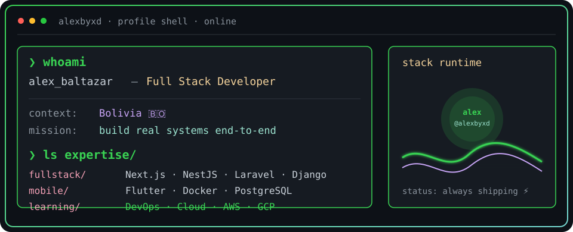

<!-- BANNER: vim profile.yml — synthwave -->
<a href="https://github.com/Alexbyxd">
  <picture>
    <source media="(prefers-color-scheme: dark)"  srcset="assets/banner-dark.svg">
    <source media="(prefers-color-scheme: light)" srcset="assets/banner-dark.svg">
    
  </picture>
</a>

 

---

## `$ whoami`

  

 

## `$ cat tech-stack.yaml`

<table border="1" cellpadding="14" bgcolor="#1a0a2e">
  <thead>
    <tr>
      <th colspan="2" align="left"><code>alexbyxd:~$ cat tech-stack.yaml</code></th>
    </tr>
  </thead>
  <tbody>
    <tr>
      <td width="50%" valign="top"><code>├─ ✦ frontend:</code>  
         
        <code>Next.js · React · TypeScript · JavaScript · Tailwind</code>
      </td>
      <td width="50%" valign="top"><code>├─ 📱 mobile:</code>  
         
        <code>Flutter · Dart</code>
      </td>
    </tr>
    <tr>
      <td valign="top"><code>├─ ⚙ backend:</code>  
         
        <code>NestJS · Laravel · Django · Node.js · Python · PHP</code>
      </td>
      <td valign="top"><code>├─ ▣ databases:</code>  
         
        <code>PostgreSQL · MySQL · MongoDB · Redis</code>
      </td>
    </tr>
    <tr>
      <td valign="top"><code>├─ 🐳 containers_devops:</code>  
         
        <code>Docker · GitHub Actions · Git · Linux · Bash</code>
      </td>
      <td valign="top"><code>╰─ ☁ currently_learning:</code>  
         
        <code>AWS · GCP · Kubernetes · Terraform</code>
      </td>
    </tr>
  </tbody>
  <tfoot>
    <tr>
      <td colspan="2"><code>status: ready&nbsp;&nbsp;·&nbsp;&nbsp;environment: production&nbsp;&nbsp;·&nbsp;&nbsp;location: Bolivia 🇧🇴</code></td>
    </tr>
  </tfoot>
</table>

---

## `$ git stats --signals alexbyxd`

  <picture>
    <source media="(prefers-color-scheme: dark)"  srcset="assets/radar-dark.svg">
    <source media="(prefers-color-scheme: light)" srcset="assets/radar-light.svg">
    
  </picture>&nbsp;
  <picture>
    <source media="(prefers-color-scheme: dark)"  srcset="assets/radar-langs-dark.svg">
    <source media="(prefers-color-scheme: light)" srcset="assets/radar-langs-light.svg">
    
  </picture>

<code>signals: fullstack_skill_radar · language_stack_radar · status: healthy</code>

 

---

<!-- SOCIALS -->
## `$ connect --socials`

&nbsp;&nbsp;
&nbsp;&nbsp;
&nbsp;&nbsp;

 
 

Hecho con ⚡ y mucho café desde Bolivia 🇧🇴 · @alexbyxd

