<!-- BANNER: vim profile.yml with animated particle morphing -->

  

---

## `$ whoami`

  

 

## `$ cat tech-stack.yaml`

<!-- ANIMATED SYNTHWAVE TECH STACK -->

  

---

## `$ git stats --signals alexbyxd`

  &nbsp;
  

<code>signals: fullstack_skill_radar · language_stack_radar · status: healthy</code>

 

---

<!-- SOCIALS -->
## `$ connect --socials`

&nbsp;&nbsp;
&nbsp;&nbsp;
&nbsp;&nbsp;

 
 

Hecho con ⚡ y mucho café desde Bolivia 🇧🇴 · @alexbyxd

