<!-- BANNER: vim profile.yml with animated particle morphing -->
<a href="https://github.com/Alexbyxd">
  <picture>
    <source media="(prefers-color-scheme: dark)"  srcset="assets/banner-dark.svg">
    <source media="(prefers-color-scheme: light)" srcset="assets/banner-light.svg">
    
  </picture>
</a>

 

<!-- CONSOLE RETRO TYPING SVG -->

---

## `$ whoami`

  

 

## `$ cat tech-stack.yaml`

<!-- ANIMATED SYNTHWAVE TECH STACK -->

  

---

## `$ git stats --signals alexbyxd`

  <picture>
    <source media="(prefers-color-scheme: dark)"  srcset="assets/radar-dark.svg">
    <source media="(prefers-color-scheme: light)" srcset="assets/radar-light.svg">
    
  </picture>&nbsp;
  <picture>
    <source media="(prefers-color-scheme: dark)"  srcset="assets/radar-langs-dark.svg">
    <source media="(prefers-color-scheme: light)" srcset="assets/radar-langs-light.svg">
    
  </picture>

<code>signals: fullstack_skill_radar · language_stack_radar · status: healthy</code>

 

---

<!-- SOCIALS -->
## `$ connect --socials`

&nbsp;&nbsp;
&nbsp;&nbsp;
&nbsp;&nbsp;

 
 

Hecho con ⚡ y mucho café desde Bolivia 🇧🇴 · @alexbyxd

